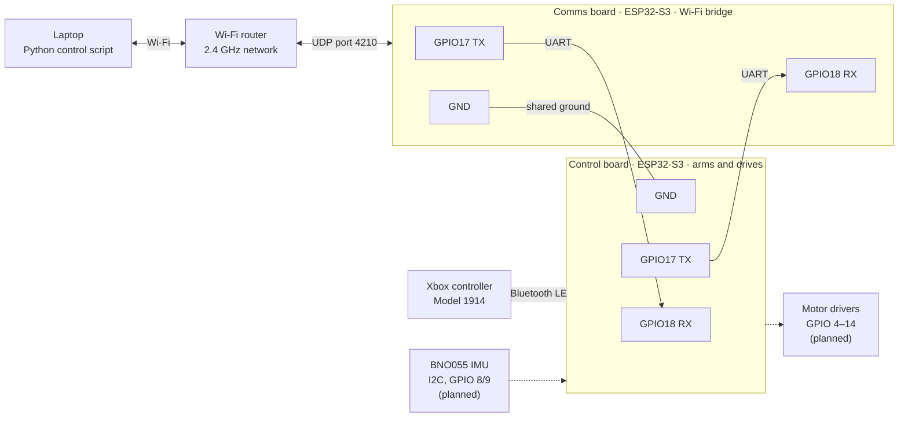

# RWA — MB001 ESP32-S3 Controllers

Arduino firmware for the two ESP32-S3-N16R8 boards in the MB001 motorcycle project.

| Folder | Board | Version | What it does |
|---|---|---|---|
| `MB001_Control/` | Control board | `0.5.0-link-bench` | Arming, faults, watchdogs, Xbox BLE input, USB diagnostics. Will drive the motors and read the IMU. |
| `MB001_Comms/` | Comms board | `0.1.0-comms-bench` | Wi-Fi bridge: relays text commands between the Python control script (UDP) and the control board (UART). |
| `verification/` | — | — | Host-side C++ tests for both boards. |

Open each `.ino` in its own Arduino IDE window. Setup and operating notes:
- [Control board](MB001_Control/README.txt) (Bluepad32 board package, Xbox pairing)
- [Comms board](MB001_Comms/README.txt) (Wi-Fi setup, wiring, UDP protocol)

**Status:** bench builds only. Motor outputs and IMU readings are not implemented. The UART link between the boards carries diagnostics and stop/recovery commands only; Xbox still owns movement.

## How it all connects

Solid lines are in the code now. Dashed lines are planned but not built yet.



- **Wi-Fi and the board link carry commands both ways.** The Python script's commands go down to the control board, and status replies come back up the same path: laptop → Wi-Fi router → comms board (UDP port 4210) → control board (UART).
- **The comms board only forwards.** It passes known commands to the control board and relays the replies. It never arms or drives anything itself.
- **The Xbox controller pairs directly with the control board** over Bluetooth LE. It is the only input that can arm or drive. Wi-Fi and USB can check status, `STOP` and `CLEAR_FAULT`, but not move anything.
- **The UART link is three wires.** The data wires cross over: comms GPIO17 (TX) goes to control GPIO18 (RX), and control GPIO17 (TX) goes to comms GPIO18 (RX). GND connects straight across. See [Connecting the boards](#connecting-the-boards-uart) for the full steps.
- **USB on each board is separate.** It is for uploading firmware and the Serial Monitor; the boards don't talk to each other over USB.
- **Planned on the control board:** three stepper motor drivers (throttle, brake, steering) on GPIO 4–14, and a BNO055 IMU on I2C (SDA GPIO8, SCL GPIO9). The pins are reserved but nothing drives or reads them yet.
- **Why the controller isn't on the comms board:** the ESP32-S3 has one radio shared by Wi-Fi and Bluetooth. Keeping Bluetooth on the control board and Wi-Fi on the comms board means neither has to share the radio.

## Connecting the boards (UART)

The boards talk over a UART serial link: 115200 baud, 8N1, one text command per line. You need the control board on `0.5.0-link-bench` or later and the comms board on `0.1.0-comms-bench` or later.

### Wiring

Unplug both boards before wiring. You need 3 jumper wires, and **the two data wires cross over**:

```
   COMMS BOARD                 CONTROL BOARD
   GPIO17 (TX) ──────────────▶ GPIO18 (RX)
   GPIO18 (RX) ◀────────────── GPIO17 (TX)
   GND         ─────────────── GND
```

| Comms board pin | Control board pin | Purpose |
|---|---|---|
| GPIO17 (TX) | GPIO18 (RX) | Commands from the comms board to the control board |
| GPIO18 (RX) | GPIO17 (TX) | Replies from the control board to the comms board |
| GND | GND | Shared ground (**required**) |

- **Cross TX and RX.** Each board's TX (transmit) goes to the other board's RX (receive). Wiring 17 to 17 is the most common mistake.
- **The ground wire is required.** Without a shared ground the boards read random bytes.
- **Use the GPIO numbers printed on the board**, not header pin positions.
- **On the bench, power each board from its own USB cable.** Do not connect the 5V or 3V3 pins of the two boards together. Both boards use 3.3 V logic, so no level shifter is needed.
- **Keep the wires short** (under about 30 cm). On the bike, run the ground wire alongside the two signal wires.

### First bench test

1. **Upload the firmware.** On the comms board, copy `MB001_Comms/WifiSecrets.example.h` to `WifiSecrets.h` in the same folder first; the Wi-Fi details can be placeholders until step 7. (`WifiSecrets.h` is deliberately not in the repo, so your password never gets pushed. In the Arduino IDE you can make it with **⋯ → New Tab**.) Then upload `MB001_Comms` to it. Upload `MB001_Control` to the control board.
2. **Noise check before wiring.** Open the control board's Serial Monitor (115200 baud, Newline) and type `HEALTH` a few times over about 10 seconds. `frame_errors` should stay at 0, which shows the unconnected link pin isn't picking up noise.
3. **Wire the boards** as shown above, then plug in both USB cables. To watch both Serial Monitors at once, open each sketch in its own Arduino IDE window.
4. **Check the comms board's monitor.** Within about a second you should see `BRIDGE link=UP`. Then type:
   - `PING` → you should get `CTRL> PONG`
   - `STATUS` → you should get `CTRL> STATUS version=0.5.0-link-bench ...`
5. **Check the control board's monitor.** Type `HEALTH`. On the `LINK` line, `link_commands` should go up about once a second; those are the comms board's keepalive pings.
6. **Pull the link.** Unplug one data wire. About 2.5 seconds later the comms board should print `BRIDGE link=DOWN`. Plug it back in and check that `link=UP` returns.
7. **Wi-Fi.** Put your real network name and password in `MB001_Comms/WifiSecrets.h` (2.4 GHz only; a network that needs a username login won't work) and re-upload the comms board. Its monitor should print `WIFI connected ip=...`. From a laptop on the same network, run the Python test snippet in [`MB001_Comms/README.txt`](MB001_Comms/README.txt) using that IP. It should print a `BRIDGE ...` status line.
8. **Xbox unchanged.** On the control board, repeat the arming and stop checks from "PAIR AND CHECK" in [`MB001_Control/README.txt`](MB001_Control/README.txt): hold LB to arm, B latches `USER_STOP`, and `CLEAR_FAULT` recovers. This needs the Xbox model 1914 controller.

### Troubleshooting

| What you see | Likely cause |
|---|---|
| Link stays `DOWN` and `link_commands` stays at 0 | TX and RX are not crossed. Swap the two data wires. |
| `frame_errors` keeps climbing on the control board | Missing or loose ground wire. |
| `ERR SERIAL_FRAME_DISCARDED_SEND_NEWLINE` on the control board | Noise or a partial line on the link. Check the wiring, then send a blank line. |
| Control board latched `SERIAL_FRAME_ERROR` | Bad data arrived on the link while armed. Fix the wiring, then send `CLEAR_FAULT`. |

**Safety:** if bad data arrives on either input while the Xbox controller has the board armed, the control board latches a fault. A loose link cable fails safe, but don't unplug the link while armed unless you are testing that.

## Commands

All commands are plain text, **UPPERCASE**, one per line, and at most 95 characters. Every command is answered on the same port it came in on.

### Where you can send them

| From | How | What happens |
|---|---|---|
| Control board USB | Serial Monitor, 115200 baud, Newline | Handled directly by the control board |
| Comms board USB | Serial Monitor, 115200 baud, Newline | `BRIDGE` is answered by the comms board. Control board commands are forwarded, and replies come back prefixed with `CTRL> `. |
| Wi-Fi (Python script) | UDP to the comms board, port 4210; the trailing newline is optional | Same as comms board USB, but replies come back with no prefix |

### Control board commands

These work from all three places above.

| Command | Reply | What it does |
|---|---|---|
| `HELP` | 3 lines | Lists the commands and the Xbox controls. |
| `VERSION` | e.g. `0.5.0-link-bench` | Prints the control board firmware version. |
| `PING` | `PONG` | Checks that the board is answering. Changes nothing. |
| `STATUS` | `STATUS ...` and `GAMEPAD ...` lines | Shows the state (`DISARMED`/`ARMED`/`FAULT`), the fault code, uptime and the requested throttle/brake/steering. Also shows the Xbox controller's connection and raw inputs. These are requested values, not measured motor positions. |
| `HEALTH` | `HEALTH`, `BLUETOOTH`, `LINK`, `PINS` lines | Shows memory, flash, reset reason and error/fault counters. Also shows Bluetooth state, link pins and per-port command counts, plus the reserved GPIO pins. |
| `DISARM` | `OK` | Resets requested throttle/brake/steering to 0 and goes to `DISARMED`. It cannot clear a latched fault. You must release LB before arming again. |
| `STOP` | `OK` | Resets all requests to 0 and latches a `USER_STOP` fault. Stays in `FAULT` until `CLEAR_FAULT`. **Not a physical emergency stop.** |
| `CLEAR_FAULT` | `OK` or `ERR NO_LATCHED_FAULT` | Clears a latched fault and returns to `DISARMED`. You must release LB before arming again. |
| `TELEMETRY 1` | `OK` | Sends a `STATUS` report about 4 times a second, only on the port that sent the command. Reports are skipped if the port is backed up. |
| `TELEMETRY 0` | `OK` | Turns those reports off for that port. Any other number replies `ERR TELEMETRY_EXPECTS_0_OR_1`. |

USB, the link and Wi-Fi **cannot arm or move anything**. Only the Xbox controller can (see below).

### Comms board commands

| Command | Reply | What it does |
|---|---|---|
| `BRIDGE` | `BRIDGE ...` line | The comms board's own status: version, `link=UP/DOWN`, Wi-Fi state, IP address, signal strength (`rssi`), UDP port, current Wi-Fi client, and counters for forwarded lines, rejected commands and errors. Works from comms board USB and Wi-Fi. |

The comms board also sends these on its own:

| Message | Meaning |
|---|---|
| `BRIDGE link=UP` / `BRIDGE link=DOWN` | The control board started or stopped answering. `DOWN` means nothing was heard for 2.5 s. |
| `WIFI connected ip=... udp_port=4210 hostname=mb001-comms.local` | Joined the Wi-Fi network (USB only). Use this IP in the Python script. |
| `WIFI disconnected` / `WIFI client timed out` | Lost Wi-Fi (it retries automatically), or the Python script stopped sending for 1 s (USB only). |

### Error replies

| Reply | From | Cause |
|---|---|---|
| `ERR SYNTAX` | Control | Unknown command, wrong number of words, a bad number, or lowercase. |
| `ERR SERIAL_FRAME_DISCARDED_SEND_NEWLINE` | Control | A non-printable byte, a line over 95 characters, or half a line with no newline for 250 ms. **If the board is armed, this also latches `SERIAL_FRAME_ERROR`.** |
| `ERR NO_LATCHED_FAULT` | Control | `CLEAR_FAULT` was sent with no fault to clear. |
| `ERR TELEMETRY_EXPECTS_0_OR_1` | Control | `TELEMETRY` was given a number other than 0 or 1. |
| `ERR BRIDGE_UNKNOWN_COMMAND` | Comms | Not a command the control board knows, so it was not forwarded. |
| `ERR BRIDGE_BAD_LINE` | Comms | A non-printable byte or a line over 95 characters. |
| `ERR BRIDGE_PARTIAL_LINE_DROPPED` | Comms (USB) | Half a line with no newline for 250 ms. |
| `ERR BRIDGE_BUSY` | Comms (Wi-Fi) | Another device is in control. Wait until it has been quiet for 1 s. |
| `ERR BRIDGE_PACKET_TOO_LONG` | Comms (Wi-Fi) | UDP packet over 512 bytes. |
| `WARN BRIDGE_LINK_DOWN` | Comms | The command was forwarded, but the control board has not answered recently. |

### Xbox controller (movement)

| Input | Action |
|---|---|
| Hold **LB** | Arms the board. First release LB, both triggers and the stick, then hold LB while the triggers and stick stay neutral. Releasing LB disarms and resets requests to 0. |
| **RT** | Throttle request, 0–100%. |
| **LT** | Brake request, 0–100%. Brake wins over throttle. |
| **Left stick X** | Steering request, -100 to 100. |
| **B** | Latches `USER_STOP`. Needs `CLEAR_FAULT` to recover. |

### States and fault codes

`STATUS` shows `state=` as `DISARMED`, `ARMED` or `FAULT`. A fault stays latched until `CLEAR_FAULT`, and `fault=` keeps the **first** cause:

| Fault | Cause |
|---|---|
| `NONE` | No fault. |
| `USER_STOP` | `STOP` command or the Xbox **B** button. |
| `SERIAL_FRAME_ERROR` | Bad data on USB or the link while armed. |
| `GAMEPAD_DISCONNECTED` | Xbox controller disconnected while armed. |
| `GAMEPAD_TIMEOUT` | No new Xbox input for 500 ms while armed. |
| `COMMAND_TIMEOUT` | Backup watchdog: no new movement request for 2 s while armed. |

## Running the tests

```
cd verification
g++ -std=c++17 -fsanitize=address,undefined comms_test.cpp ../MB001_Comms/BridgeLogic.cpp -o comms_test && ./comms_test
g++ -std=c++17 -fsanitize=address,undefined controller_test.cpp ../MB001_Control/Controller.cpp ../MB001_Control/Protocol.cpp -o controller_test && ./controller_test
g++ -std=c++17 -fsanitize=address,undefined gamepad_test.cpp ../MB001_Control/GamepadInput.cpp ../MB001_Control/Controller.cpp -o gamepad_test && ./gamepad_test
g++ -std=c++17 -fsanitize=address,undefined -Istubs ble_adapter_test.cpp ../MB001_Control/XboxBle.cpp ../MB001_Control/GamepadInput.cpp ../MB001_Control/Controller.cpp -o ble_adapter_test && ./ble_adapter_test
```
